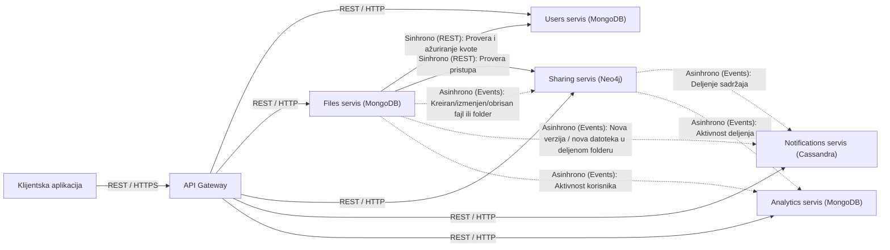

# 2.1 Dizajn sistema

Ovaj dokument definiše arhitekturu i dizajn sistema za platformu za skladištenje i deljenje datoteka:
1. **Odgovornost svakog servisa i korišćene baze podataka**
2. **Modeli podataka i atributi entiteta za sve mikroservise (`Users`, `Files`, `Sharing`, `Notifications`, `Analytics`)**
3. **Načini i stilovi komunikacije između servisa**

---

## 1. Odgovornost svakog servisa

| Servis / Komponenta | Odgovornost u sistemu | Baza podataka |
| :--- | :--- | :--- |
| **API Gateway** | Ulazna tačka u sistem preko koje klijentska aplikacija komunicira sa serverskim mikroservisima putem REST API-ja. | — (Stateless) |
| **Users servis** | Čuva kredencijale korisnika, njihove uloge (`RK` — redovan korisnik, `A` — administrator), osnovne podatke (ime, prezime, imejl) i kvote skladišta. Zadužen je za registraciju, potvrdu registracije, 2FA prijavu (lozinka + OTP), promenu/reset lozinke, povraćaj naloga (magični link) i obradu zahteva za povećanje kvote. | **MongoDB** (dokument-orijentisana baza) |
| **Files servis** | Čuva metapodatke o datotekama i folderima: naziv, tip, veličinu, vlasnika, roditeljski folder, vremenske oznake i referencu na sadržaj datoteke. Upravlja kreiranjem foldera, otpremanjem datoteka i njihovih novih verzija, pregledom i preimenovanjem sadržaja foldera. | **MongoDB** (metapodaci) + **Object Store** (sadržaj datoteka) |
| **Sharing servis** | Čuva informacije o korisničkim grupama i o tome koji korisnici ili grupe imaju pristup kojim datotekama i folderima. | **Neo4j** (graf baza) |
| **Notifications servis** | Upravlja skladištenjem i dobavljanjem notifikacija za korisnike o deljenju i izmenama sadržaja. | **Apache Cassandra** (wide-column baza) |
| **Analytics servis** | Čuva informacije o istoriji aktivnosti korisnika i služi za računanje analitika vezanih za datoteke i zauzeće skladišta. | **MongoDB** (dokument-orijentisana baza) |

---

## 2. Modeli podataka i atributi entiteta

### 2.1 `Users` servis (MongoDB)
Implementacija: [`services/users-service/internal/model/user.go`](../services/users-service/internal/model/user.go)

#### Entitet: `User` (kolekcija `users`)
| Atribut | Tip | Opis |
| :--- | :--- | :--- |
| `id` (`_id`) | `string` | Jedinstveni identifikator korisnika |
| `firstName` | `string` | Ime korisnika |
| `lastName` | `string` | Prezime korisnika |
| `email` | `string` | Jedinstvena imejl adresa korisnika |
| `passwordHash` | `string` | Heširana lozinka (bcrypt sa solju) |
| `role` | `Role` (`RK` \| `A`) | Uloga u sistemu (`RK` — Redovan korisnik, `A` — Administrator) |
| `isVerified` | `bool` | Da li je nalog potvrđen putem imejla |
| `quotaLimit` | `int64` | Maksimalna dozvoljena kvota skladišta u bajtovima |
| `quotaUsed` | `int64` | Trenutno zauzeće skladišta u bajtovima |
| `passwordChangedAt` | `time.Time` | Vreme poslednje promene lozinke (min 1 dan, max 60 dana) |
| `failedLoginAttempts` | `int` | Broj uzastopnih neuspelih pokušaja prijave |
| `lockedUntil` | `*time.Time` | Vreme do kog je nalog privremeno zaključan |
| `createdAt` | `time.Time` | Vreme kreiranja naloga |
| `updatedAt` | `time.Time` | Vreme poslednje izmene naloga |

#### Entitet: `AuthToken` (kolekcija `auth_tokens`)
| Atribut | Tip | Opis |
| :--- | :--- | :--- |
| `id` (`_id`) | `string` | Jedinstveni identifikator tokena |
| `email` | `string` | Imejl adresa korisnika |
| `codeHash` | `string` | Heširana vrednost jednokratnog koda / linka |
| `type` | `TokenType` | `VERIFY_EMAIL`, `LOGIN_OTP`, `PASSWORD_RESET`, `MAGIC_LINK` |
| `expiresAt` | `time.Time` | Vreme isteka važenja koda |
| `used` | `bool` | Da li je kod već iskorišćen |
| `createdAt` | `time.Time` | Vreme kreiranja koda |

#### Entitet: `RevokedToken` (kolekcija `revoked_tokens`)
| Atribut | Tip | Opis |
| :--- | :--- | :--- |
| `id` (`_id`) | `string` | Jedinstveni identifikator zapisa |
| `token` | `string` | Odjavljeni JWT token (blacklist) |
| `expiresAt` | `time.Time` | Vreme isteka JWT tokena |
| `createdAt` | `time.Time` | Vreme odjave |

#### Entitet: `QuotaRequest` (kolekcija `quota_requests`)
| Atribut | Tip | Opis |
| :--- | :--- | :--- |
| `id` (`_id`) | `string` | Jedinstveni identifikator zahteva |
| `userId` | `string` | ID korisnika koji podnosi zahtev |
| `userEmail` | `string` | Imejl adresa korisnika |
| `currentQuota` | `int64` | Trenutna kvota u bajtovima |
| `requestedQuota` | `int64` | Tražena nova kvota u bajtovima |
| `reason` | `string` | Obrazloženje zahteva |
| `status` | `QuotaRequestStatus` | Status: `PENDING`, `APPROVED`, `REJECTED` |
| `resolvedBy` | `string` | ID administratora koji je obradio zahtev |
| `resolvedAt` | `*time.Time` | Vreme obrade zahteva |
| `createdAt` | `time.Time` | Vreme podnošenja zahteva |

---

### 2.2 `Files` servis (MongoDB + Object Store)
Implementacija: [`services/files-service/internal/model/file.go`](../services/files-service/internal/model/file.go)

#### Entitet: `Folder` (kolekcija `folders`)
| Atribut | Tip | Opis |
| :--- | :--- | :--- |
| `id` (`_id`) | `string` | Jedinstveni identifikator foldera |
| `name` | `string` | Naziv foldera |
| `ownerId` | `string` | ID vlasnika foldera |
| `parentFolderId` | `*string` | ID roditeljskog foldera (`null` za korenski folder) |
| `createdAt` | `time.Time` | Vreme kreiranja foldera |
| `updatedAt` | `time.Time` | Vreme poslednje izmene foldera |

#### Entitet: `FileMetadata` (kolekcija `files`)
| Atribut | Tip | Opis |
| :--- | :--- | :--- |
| `id` (`_id`) | `string` | Jedinstveni identifikator datoteke |
| `name` | `string` | Naziv datoteke |
| `mimeType` | `string` | Tip datoteke (npr. `text/plain`, `image/png`, `application/pdf`) |
| `size` | `int64` | Veličina datoteke u bajtovima |
| `ownerId` | `string` | ID vlasnika datoteke |
| `parentFolderId` | `*string` | ID roditeljskog foldera (`null` za korenski folder) |
| `contentRef` | `string` | Referenca na binarni sadržaj datoteke u Object Store-u |
| `version` | `int` | Broj trenutne verzije datoteke |
| `checksum` | `string` | Heš vrednost za proveru integriteta datoteke |
| `createdAt` | `time.Time` | Vreme prvog otpremanja datoteke |
| `updatedAt` | `time.Time` | Vreme poslednje izmene / nove verzije |

---

### 2.3 `Sharing` servis (Neo4j graf baza)
Implementacija: [`services/sharing-service/internal/model/sharing.go`](../services/sharing-service/internal/model/sharing.go)

| Čvor / Relacija | Atributi | Opis |
| :--- | :--- | :--- |
| **`UserNode` (`:User`)** | `userId` (`string`), `email` (`string`) | Korisnik u grafu pristupa |
| **`GroupNode` (`:Group`)** | `groupId` (`string`), `name` (`string`), `ownerId` (`string`), `createdAt` (`time.Time`) | Grupa korisnika kojom upravlja vlasnik |
| **`ResourceNode` (`:Resource`)** | `resourceId` (`string`), `resourceType` (`FILE` \| `FOLDER`), `ownerId` (`string`), `parentFolderId` (`*string`) | Datoteka ili folder u grafu pristupa |
| **`Share` (`[:SHARED_WITH]`)** | `id` (`string`), `resourceId` (`string`), `resourceType` (`string`), `targetId` (`string`), `targetType` (`USER` \| `GROUP`), `sharedAt` (`time.Time`) | Relacija deljenja resursa sa pojedinačnim korisnikom ili grupom |

---

### 2.4 `Notifications` servis (Apache Cassandra — Wide-Column baza)
Implementacija: [`services/notifications-service/internal/model/notification.go`](../services/notifications-service/internal/model/notification.go)

#### Entitet: `Notification` (tabela `notifications_by_user`)
| Kolona | Tip | Ključ u Cassandri | Opis |
| :--- | :--- | :--- | :--- |
| `userId` (`user_id`) | `string` | **Partition Key** | ID korisnika koji prima notifikaciju |
| `createdAt` (`created_at`) | `time.Time` | **Clustering Key (DESC)** | Vreme kreiranja notifikacije |
| `id` | `string` | **Clustering Key** | Jedinstveni identifikator notifikacije |
| `type` | `string` | — | Tip događaja (`FILE_SHARED`, `FOLDER_SHARED`, `NEW_VERSION`) |
| `resourceId` (`resource_id`) | `string` | — | ID datoteke ili foldera |
| `resourceName` (`resource_name`) | `string` | — | Naziv datoteke ili foldera |
| `message` | `string` | — | Tekst notifikacije za prikaz u klijentskoj aplikaciji |
| `isRead` (`is_read`) | `bool` | — | Indikator da li je notifikacija pročitana |

---

### 2.5 `Analytics` servis (MongoDB)
Implementacija: [`services/analytics-service/internal/model/analytics.go`](../services/analytics-service/internal/model/analytics.go)

#### Entitet: `Activity` (istorija aktivnosti korisnika)
| Atribut | Tip | Opis |
| :--- | :--- | :--- |
| `id` (`_id`) | `string` | Jedinstveni identifikator aktivnosti |
| `userId` | `string` | ID korisnika |
| `action` | `string` | Vrsta akcije (`UPLOAD`, `RENAME`, `DELETE`, `DOWNLOAD`, `SHARE`) |
| `resourceId` | `string` | ID datoteke ili foldera |
| `resourceName` | `string` | Naziv datoteke ili foldera |
| `resourceType` | `string` | Tip resursa (`FILE` ili `FOLDER`) |
| `createdAt` | `time.Time` | Vreme izvršavanja aktivnosti |

#### Entitet: `AccountAnalytics` (analitika naloga)
| Atribut | Tip | Opis |
| :--- | :--- | :--- |
| `userId` | `string` | ID korisnika |
| `totalStorageUsed` | `int64` | Ukupno zauzeće skladišta u bajtovima |
| `fileCountByType` | `map[string]int` | Broj datoteka po tipu |
| `topAccessedFiles` | `[]string` | Pet datoteka kojima je korisnik pristupio najveći broj puta |
| `sharedWithMeCount` | `int` | Broj datoteka koje su podeljene sa korisnikom |
| `updatedAt` | `time.Time` | Vreme poslednjeg obračuna analitike |

---

## 3. Stilovi i načini komunikacije između servisa

1. **Komunikacija Klijent ↔ API Gateway ↔ Mikroservisi (Sinhrona REST komunikacija)**:
   - Klijentska aplikacija komunicira isključivo sa **API Gateway**-em putem **HTTPS REST API-ja** (JSON i `multipart/form-data`).
   - **API Gateway** prosleđuje zahteve odgovarajućim mikroservisima putem sinhronih HTTP/REST poziva.

2. **Sinhrona komunikacija između servisa (REST / HTTP — zahtev 2.5)**:
   - **`Files` → `Users`**: Prilikom otpremanja datoteke ili nove verzije (zahtev 1.5), `Files` servis sinhrono poziva `Users` servis kako bi proverio da li korisnik ima dovoljno slobodne kvote skladišta i ažurirao zauzeće (`quotaUsed`).
   - **`Files` → `Sharing`**: Prilikom pristupa datoteci ili pretrage, `Files` servis sinhrono proverava kod `Sharing` servisa da li korisnik ima pravo pristupa traženom sadržaju.

3. **Asinhrona komunikacija između servisa (Pub/Sub događaji — zahtev 2.9)**:
   - **`Files` → `Sharing`**: Kada se datoteka ili folder kreira ili obriše, `Files` emituje događaj na koji `Sharing` servis reaguje radi održavanja grafa pristupa u Neo4j bazi.
   - **`Sharing` i `Files` → `Notifications`**: `Notifications` servis asinhrono sluša događaje o deljenju datoteke/foldera i otpremanju nove verzije datoteke kako bi sačuvao notifikacije za odgovarajuće korisnike u Cassandri.
   - **`Files` i `Sharing` → `Analytics`**: `Analytics` servis asinhrono prima događaje o akcijama korisnika radi beleženja istorije aktivnosti i ažuriranja analitike naloga.

